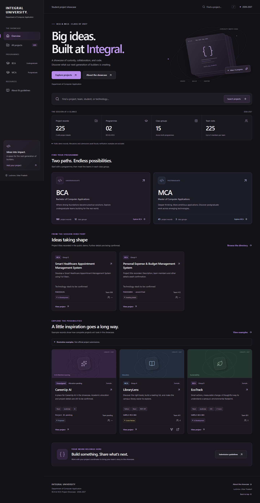
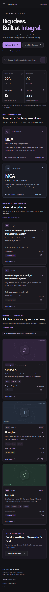

# Integral University · BCA & MCA Project Showcase

A lightweight student project directory for the **Department of Computer Application, Integral University, Lucknow**, academic session **2026–2027**. Faculty and visitors can browse programmes, class groups, teams, project details, technologies, and verified external links.

The visual design uses the supplied reference’s charcoal, gray, and purple palette. The university identity is a text wordmark; the code-symbol favicon is a generic portal icon, not an invented university logo.

## Quick start

Install **Node.js 22.12 or newer** (Node 24 LTS recommended). Open a terminal in this project folder:

```sh
npm ci
npm run dev
```

Open **http://127.0.0.1:5173**. Stop the server with Ctrl+C. The development port is fixed; close another server using 5173 or pass `-- --port 5174`.

```sh
npm run validate:data  # Validate both datasets and local thumbnails
npm run lint           # Check JavaScript and JSX
npm test               # Small suite using Node's built-in test runner
npm run build          # Validate, then build into dist/
npm run preview        # Preview the production build on port 4173
npm run check          # Validation, lint, tests and build together
```

No environment variables, accounts, database, or backend are required. `package-lock.json` pins the tested dependency tree. Use `npm ci` for repeatable installs.

## What is included

- Home with programme cards, calculated session statistics, real title records, and labeled illustrative examples.
- Programme → class group → team/project discovery, with shareable routes.
- Real-time search over titles, IDs, team names, member names/enrollment numbers, repository names, technologies, programmes, and groups.
- Programme, group, technology, category, status, and session filters that work together. Filters, search, sorting, page, and view are stored in the URL.
- Grid/list views, pagination, clear no-results states, reset filters, and direct links to each project.
- Detail pages with problem/solution, technology stack, up to five members, mentor, status, safe links, and repository-name copy.
- Responsive navigation with a native modal on small screens, keyboard focus states, skip link, and reduced-motion support.
- Generated CSS/icon thumbnails, optional image support, and graceful image/data failures.
- About, guidelines, custom 404, metadata, and Vercel SPA refresh configuration.
- CSV import with validation and protection against overwriting files.

## Pages

| Route                                 | View                                        |
| ------------------------------------- | ------------------------------------------- |
| `/`                                   | Overview                                    |
| `/projects`                           | Session directory                           |
| `/projects?collection=samples`        | Illustrative example collection             |
| `/projects?collection=all&q=react`    | Search both collections                     |
| `/programmes/bca` / `/programmes/mca` | Programme groups and statistics             |
| `/programmes/bca/groups/a`            | All team records in a class group           |
| `/projects/pugid26001`                | A directory record                          |
| `/projects/careerup-ai`               | Unassigned CareerUp AI example              |
| `/about` / `/about#contribute`        | Purpose, naming, and maintenance guidelines |
| Any unknown route                     | Not Found                                   |

Global search includes examples so CareerUp AI and sample member searches work. The directory defaults to session records. Programme and group pages show directory records. Switching collection retains the search term but clears dependent filters; reset clears all filters while preserving the selected collection. Pagination resets when a filter changes.

## Stack and structure

React 19, Vite 8, JavaScript, React Router 7, Lucide icons, and plain CSS. Node's built-in tests and a small ESLint configuration are development tools. No third-party fonts, image services, trackers, or runtime API requests are used.

```text
src/
  components/       Navigation, cards, filters, shared states, and visuals
  pages/            Home, Projects, Programme/Group, Details, About, Not Found
  hooks/            Data loading and page titles
  data/
    site.json       University identity and current academic session
    projects.json   Maintained session directory
    samples.json    Clearly labeled illustrative records
  utils/            Search, filters, statistics, normalization, validation
  styles/           Base styles and responsive layouts
  App.jsx
  main.jsx
public/              Favicon; put original project images in public/images/
scripts/             Data validation and CSV import
templates/           Editable CSV template
tests/               Node tests and stable test fixtures
docs/                Data provenance, QA results, and screenshots
vercel.json          Build and SPA routing configuration
```

## Understand the initial data before publishing

The reference site publicly identifies `data/projects.json` as its data source. Only that public data and rendered UI were inspected. No application source, CSS bundles, or minified JavaScript were copied.

`projects.json` preserves **225 public demo team allocations**, across **12 BCA groups (180 records)** and **3 MCA groups (45 records)**. These are **not verified university submissions**. There are two titled records, 223 untitled slots, no student identities, and no confirmed mentors. There are no enabled project repository/demo links in this initial directory because the one supplied pair is inconsistent.

Known discrepancies are documented in [docs/data-provenance.md](docs/data-provenance.md):

- **PUGID26044 occurs twice**, assigned to BCA C14 and H12. Both are retained with `sourceProjectId`, `recordType: "unverified-allocation"`, a visible `dataNote`, and a null official `projectId`. Their internal IDs/slugs are `unverified-bca-c14` and `unverified-bca-h12`.
- **BCA G08 / PUGID26191** links to a repository/demo naming H12 / PUGID26044. Those links are withheld with a visible explanation.
- Source status `pending` becomes `Awaiting details`; `In Progress` becomes `In Development`.

`samples.json` contains **8 examples**, excluded from session statistics. Sample learners are explicitly fictional placeholders. Two examples link to independent public reference implementations, clearly labeled as references rather than student-owned projects. CareerUp AI has **no invented programme, project ID, group, team ID, mentor, or members**; its scope and technology text are illustrative.

After faculty approval, update existing allocated slots rather than adding duplicate teams. Delete example records or set `samples.json` to `[]` if examples are no longer wanted. Dynamic badges and counts update automatically. The About page's initial-data explanation should also be updated when the official dataset replaces the demo.

## Project record format

Every record has these fields. Use an existing record as a starting point; keep unknown optional values as `null`, `""`, or `[]` as appropriate.

| Fields                                       | Meaning                                                                                                   |
| -------------------------------------------- | --------------------------------------------------------------------------------------------------------- |
| `id`, `slug`                                 | Unique internal identity and lowercase URL name. Preserve slugs to keep old links working.                |
| `projectId`, `programme`, `group`, `teamId`  | Teacher-approved allocation. Programme is BCA/MCA; group is A–Z; team ID is group + two digits, e.g. A01. |
| `academicSession`, `repositoryYear`          | Session like `2026–2027`, and numeric repository year `2027`.                                             |
| `title`, `shortDescription`, `description`   | Project name, card summary, and complete overview.                                                        |
| `problemStatement`, `solution`, `category`   | The challenge, approach, and a category chosen by the coordinator.                                        |
| `technologies`                               | Array of names, e.g. `["React", "JavaScript"]`.                                                           |
| `status`                                     | `Awaiting details`, `Proposed`, `In Development`, `Under Review`, `Completed`, or `Deployed`.             |
| `teamName`, `members`, `mentor`              | Team label, up to five member objects, and confirmed faculty mentor.                                      |
| `repositoryName`, `repositoryUrl`, `liveUrl` | Naming convention and optional valid absolute URLs.                                                       |
| `projectThumbnail`                           | Optional local path such as `/images/project.webp` or an HTTP(S) image URL.                               |
| `createdAt`, `updatedAt`                     | Actual dates in `YYYY-MM-DD`; `null` when unavailable.                                                    |
| `isSample`, `recordType`, `featured`         | Explicit sample flag, provenance type, and home-page selection flag.                                      |
| `sourceProjectId`, `dataNote`, `linkNote`    | Optional explanations for inherited allocation/link discrepancies.                                        |

Member objects support `name`, `enrollmentNumber`, `role`, `github`, `linkedin`, and `email`. Only publish real names and contact details with the required permission. Do not make up student identities. Enrollments are optional; student statistics count supplied member entries, deduplicated by enrollment where available.

### Add or update a BCA project

1. Confirm the allocation with the teacher, then locate the team in `src/data/projects.json` (for example, BCA Group A / A01).
2. Keep its approved IDs and slug. Replace the pending title, descriptions, and other supplied fields.
3. Set `programme` to `BCA`, `isSample` to `false`, and the appropriate status. Add real members and mentor only when confirmed.
4. Add verified links/images as described below, and set `updatedAt` to the actual date.
5. Run `npm run check`, inspect the page, and commit the changes.

For a genuinely new team, add one complete JSON record with a unique internal ID/slug/project ID and a team ID unused within that session, programme, and group. New group cards appear automatically. Do not append the same allocated team a second time.

### Add or update an MCA project

Follow the same steps, using `programme: "MCA"`, the teacher-approved MCA group/team, and the supplied MCA project ID. The demo's MCA IDs use `PPGID`; BCA uses `PUGID`. These are observed conventions, not permission to issue new official IDs. Team A01 can exist in both BCA and MCA because uniqueness is scoped by session/programme/group.

### Repository names and URLs

```text
[PROGRAMME][YEAR]-[PROJECT-ID]-[TEAM-ID]
BCA2027-PUGID26001-A01
MCA2027-PPGID26001-A01
```

Use the actual approved values. `repositoryName` can exist before a repository does. Add `repositoryUrl` only after verifying an actual `https://github.com/OWNER/REPOSITORY` URL. Add `liveUrl` only when the project has a working public demo. Missing links produce explanatory text; they never generate fake buttons. Sample reference names are exempt from the official naming rule.

To resolve an inherited duplicate ID, obtain the correct ID first, set `projectId` and matching `repositoryName`, change `recordType` to `reference-slot` or `approved`, and remove obsolete `sourceProjectId`/`dataNote`. Keep the internal slug so existing links continue to work.

### Project images

Place an original, permitted image in `public/images/` and set `projectThumbnail` to `/images/filename.webp`. Prefer compressed WebP/AVIF around 800×450 pixels. Don't include `public` in the data path. Keep images small (ideally under 150 KB). Missing thumbnails use category/programme visuals; failed image loads fall back automatically. Local image existence is validated during the build. No random stock images are used.

### CSV import

Copy `templates/projects.csv`, edit it in a spreadsheet or text editor, and export UTF-8 CSV. The provided row is explicitly a sample and must be replaced with approved information before entering the directory. Use `true`/`false` for booleans, pipe-separated technology names, and a JSON array in `members`. Normal CSV quoting applies: double each quotation mark inside quoted cells. Empty optional cells are supported.

```sh
npm run import:csv -- templates/projects.csv --output imported-projects.json
node scripts/validate-data.mjs imported-projects.json
```

The importer writes a **new file only** and refuses to overwrite an existing output. Review imported records and merge/update their corresponding slots in `projects.json` (or `samples.json` for examples), then run `npm run validate:data`. It deliberately does not auto-merge or delete any records. JSON is simplest for detailed team-member information.

## Validation and resilience

Validation catches required fields, supported programmes/statuses, duplicate IDs/slugs/repository names, duplicate scoped team IDs, naming mismatches, malformed URLs, invalid dates, missing local images, invalid members, and teams larger than five. It exits with a nonzero code on errors; builds cannot silently publish invalid JSON.

At runtime, data imports are caught, malformed records are omitted with a notice, optional fields are normalized, invalid URLs are suppressed, missing images fall back, and unexpected render failures offer a reload. Search and cards render plain text, not HTML from JSON. Data is loaded locally; no database or authentication is involved.

Tests use stable fixtures so adding new production records does not require rewriting utility tests. See [docs/QA.md](docs/QA.md) for the performed browser checks and their limits.

## Production and Vercel

```sh
npm ci
npm run check
npm run preview
```

Upload/push this **project folder** to your own repository. In Vercel select the Vite framework preset, install command `npm ci`, build command `npm run build`, and output directory `dist`. Keep `vercel.json`: it rewrites nested application routes to `index.html` while keeping assets accessible. No deployment has been performed by this build process.

On another static host, configure an equivalent SPA fallback. Client-side 404 pages use the host's SPA response; they are not server-rendered HTTP 404s. Social metadata is static, while browser titles update per page. Add the final canonical URL and an approved absolute `og:image` URL after choosing a domain. No fake production URL is embedded.

## Screenshots

Desktop and mobile screenshots from the local preview:



<details><summary>Mobile overview</summary>



</details>

Replace these screenshots after significant UI or dataset changes. Additional screenshot slots: programme groups, filtered directory, and project detail.

## Before the dataset becomes official

Obtain the approved programme/group/team allocations and distinct project IDs; resolve the C14/H12 collision and G08 link mismatch; confirm titles, descriptions, statuses, technology stacks, member names/enrollments, mentors, repository ownership, and live URLs. Obtain approval for any logo, project images, and public contact information. Confirm who maintains the directory and how often updates are published.
